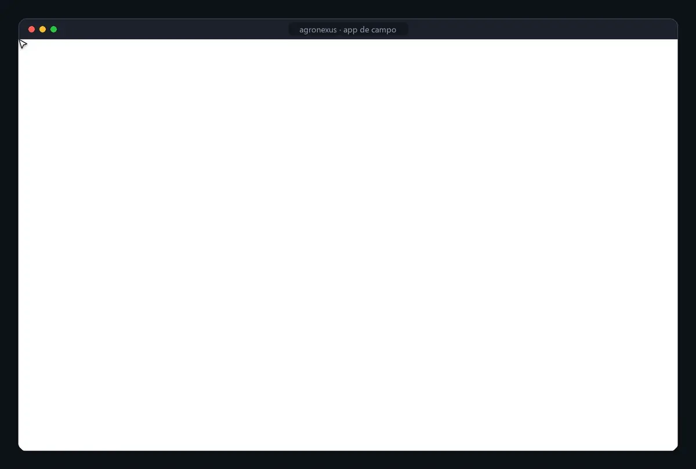
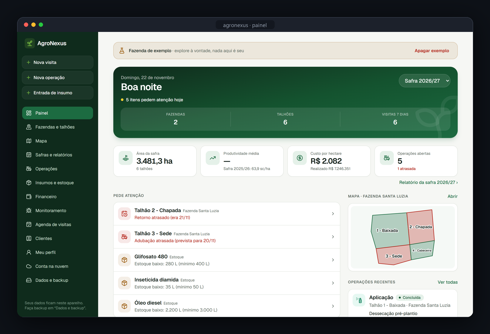
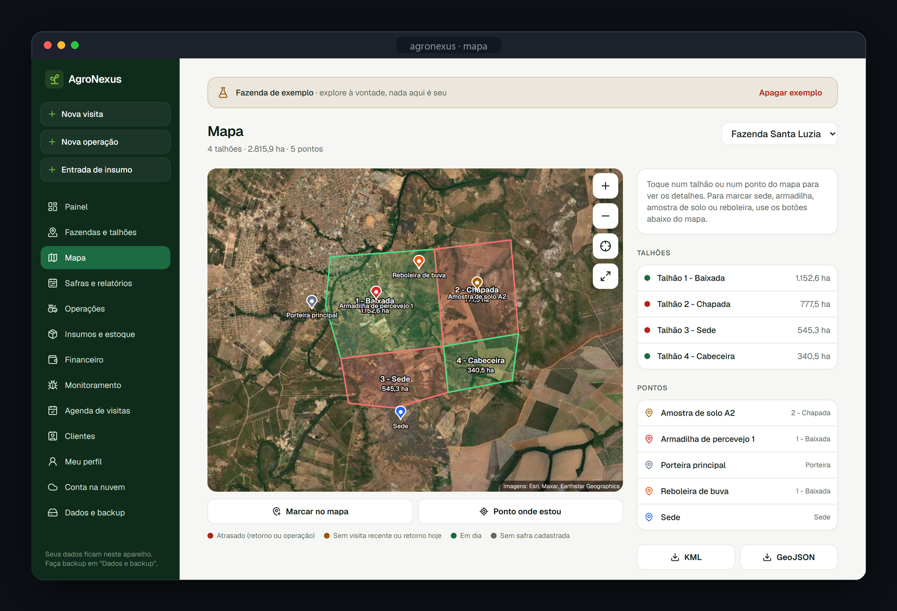
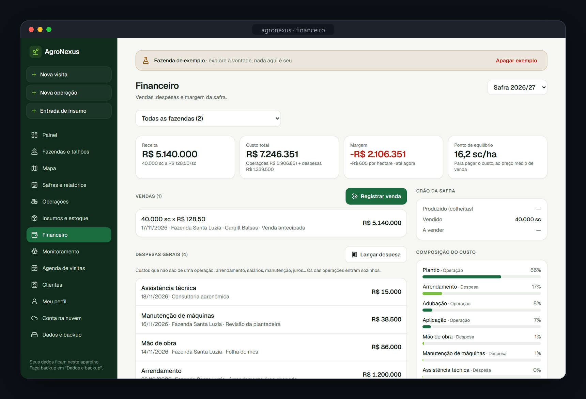
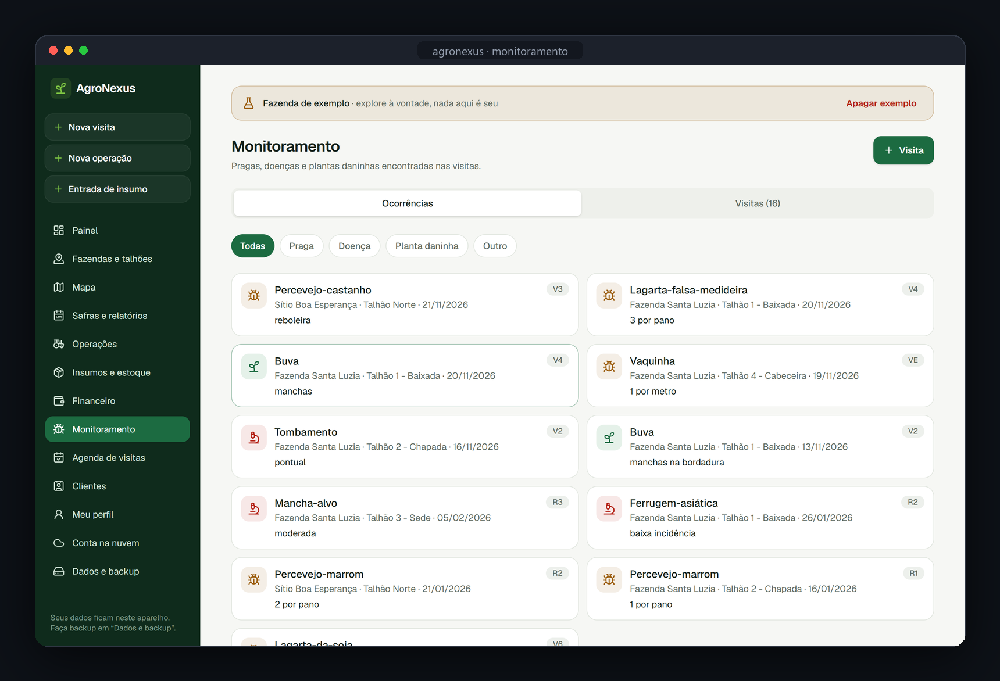
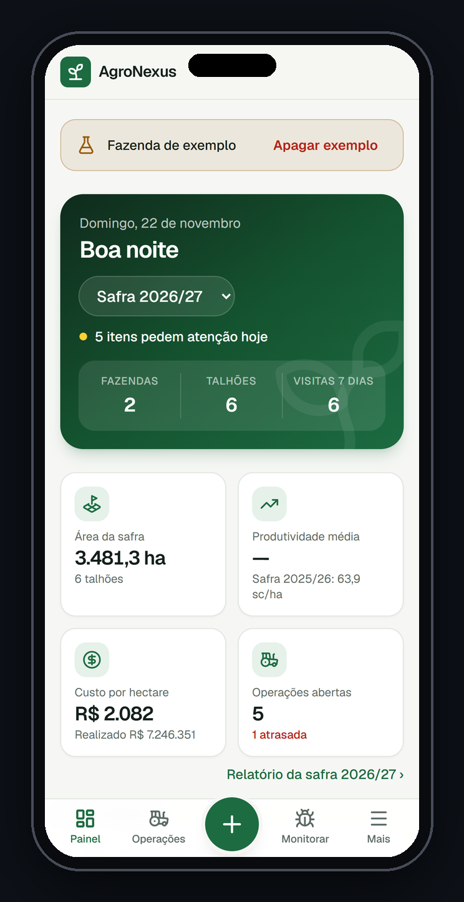
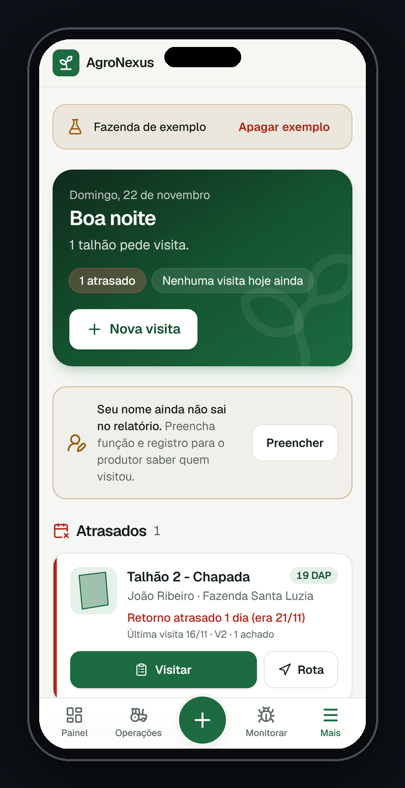
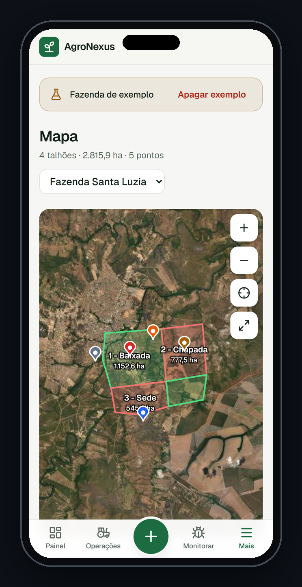
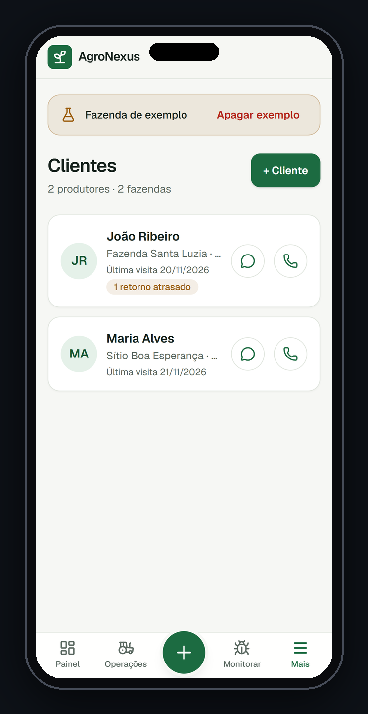

<p align="center">
  
  
  
  
  
  
</p>

<p align="center"><b>App de campo para engenheiros agrônomos e produtores rurais.</b><br/>
Registra visitas, desenha os talhões no mapa, controla insumos e mostra o resultado financeiro da safra,<br/>
<b>mesmo sem sinal no meio da lavoura.</b></p>

---

## Por que existe

No campo a internet cai. O agrônomo anota no papel ou no WhatsApp, e a informação se perde entre uma visita e outra.
O AgroNexus guarda tudo **no próprio aparelho** e sincroniza com a nuvem quando o sinal volta.

O mesmo dado serve a duas pessoas:

| | Quem usa | O que vê primeiro |
|---|---|---|
| **Vou a campo** | agrônomo, técnico, estagiário, RTV | a agenda do dia: atrasados, retornos e talhões sem visita |
| **Cuido da fazenda** | produtor e gestor | o painel da safra: área, produtividade, custo por hectare e alertas |

## 📸 Telas

<p align="center">
  
  
  
  
</p>

<p align="center">
  
  
  
  
</p>

<sub>As telas usam a <b>fazenda de exemplo</b> que vem no app (dados fictícios).</sub>

## O que ele faz

**No campo**
- Agenda "Hoje" com atrasados, retornos e talhões sem visita, e rota até o talhão
- Visitas por tipo (monitoramento, plantio, estande, pós-venda, pré-colheita, vistoria) com fotos, GPS e recomendação
- **Contagem de estande**: plantas por metro e por hectare, % da população planejada e variação entre pontos
- Relatório em PDF ou direto no WhatsApp do produtor, com assinatura e registro profissional (CREA/CFTA)

**No mapa**
- Contorno do talhão **caminhando com o GPS**, desenhado sobre o satélite ou importado de KML, KMZ e GeoJSON
- Coordenadas em graus, GMS, **UTM SIRGAS 2000** e WKT, com conversão entre elas
- Área pelo elipsoide GRS80 e exportação em WKT (formato do Sicor), KML e GeoJSON
- Satélite guardado no aparelho para abrir **offline**

**Na gestão**
- Painel da safra com área, produtividade (sc/ha), custo por hectare e "pede atenção"
- Operações, **insumos e estoque** com baixa automática e aviso de "vai faltar"
- **Financeiro**: vendas, despesas, margem por hectare e ponto de equilíbrio
- Relatório e comparação entre safras

**Nos dados**
- Funciona 100% offline (IndexedDB); a conta na nuvem sincroniza sem pisar no que ainda não subiu
- Backup em JSON e planilhas CSV de visitas, operações, estoque, vendas e despesas

## Como foi feito

| Parte | Tecnologia |
|---|---|
| App | Next.js 16 (App Router), React 19, TypeScript, Tailwind CSS 4 |
| Dados no aparelho | Dexie 4 (IndexedDB), service worker (PWA) |
| Nuvem | Supabase (Postgres, Auth e Storage), sincronização própria em `src/lib/sync` |
| Mapa | satélite Esri com cache offline, cálculo de área e UTM próprios (`src/lib/coords.ts`) |
| Qualidade | Vitest com **173 testes**, TypeScript estrito e ESLint |

As decisões de arquitetura estão em [`docs/adr`](docs/adr).

## Como rodar

```bash
cd apps/web
npm install
npm run dev        # abre em http://localhost:3000
```

Na primeira tela, clique em **"Ver com fazenda de exemplo"** para explorar com dados prontos.

```bash
npm test           # 173 testes
npx tsc --noEmit   # checagem de tipos
```

Sem as variáveis `NEXT_PUBLIC_SUPABASE_*`, o app funciona normalmente, só que sem a conta na nuvem.

## Status

**Fase 1 em andamento.** App web (PWA) completo para uso no campo, com a sincronização na nuvem pronta no código.

---

<p align="center">Feito por <a href="https://github.com/ymedeiros228"><b>Yuri Medeiros</b></a> · <a href="https://www.linkedin.com/in/yuri-medeiros-1071533b4/">LinkedIn</a></p>
